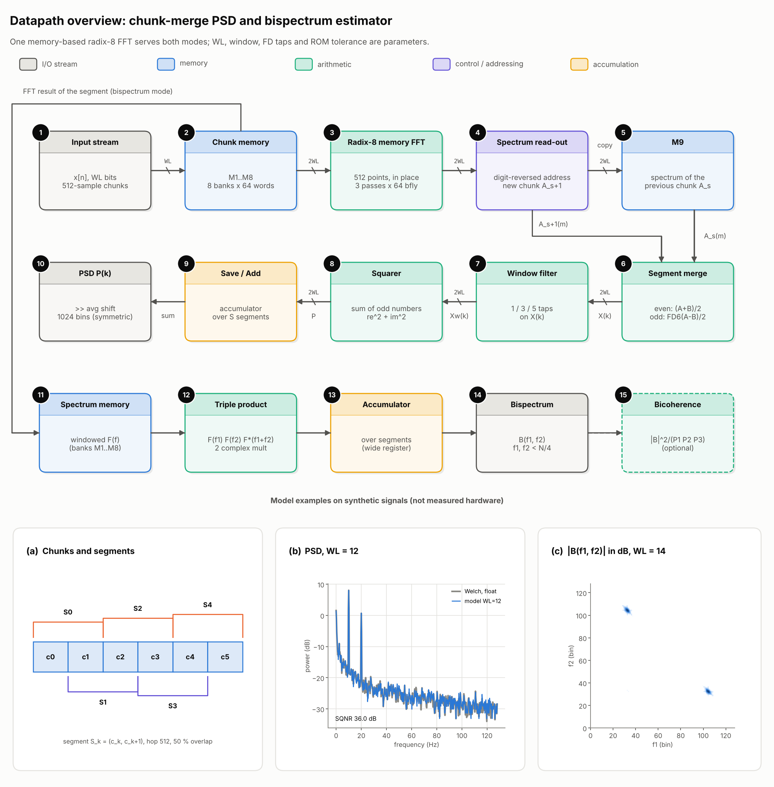
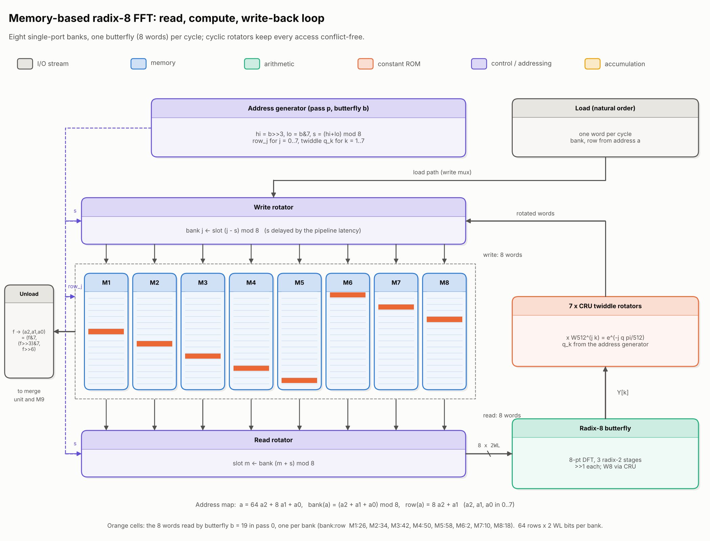
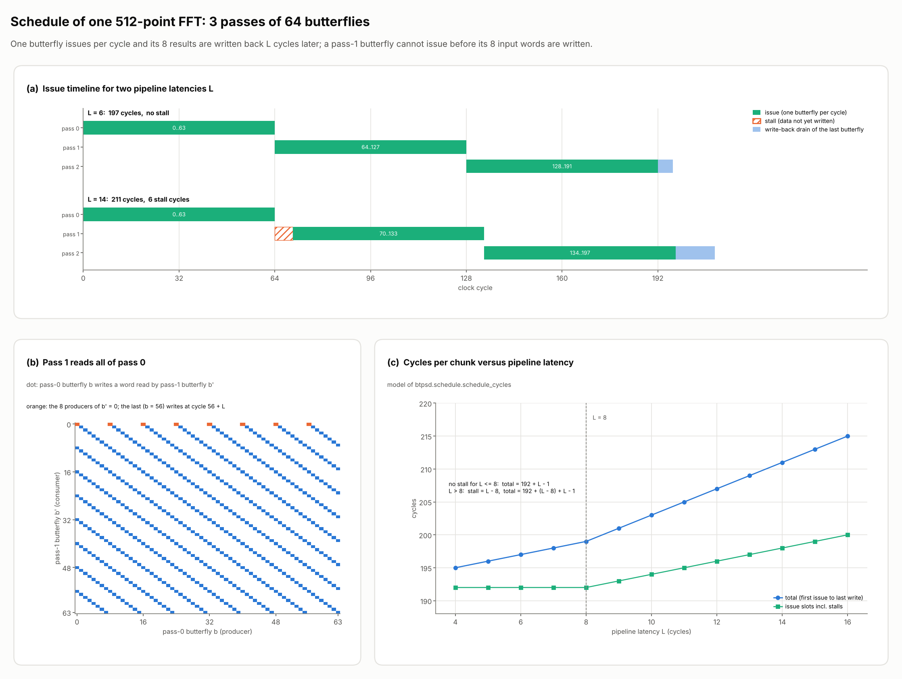
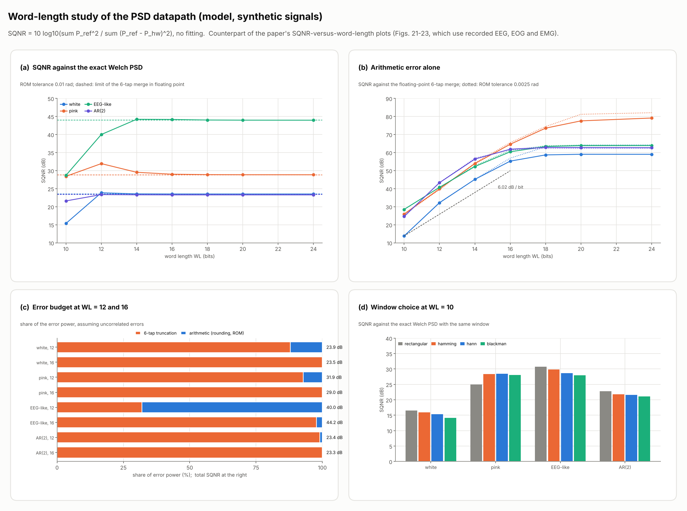
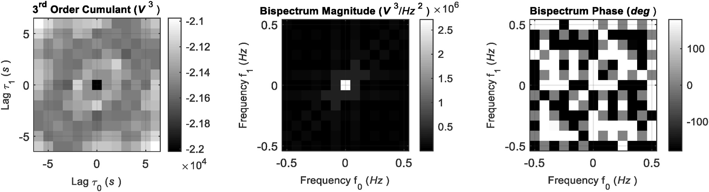
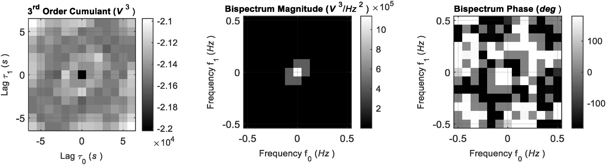
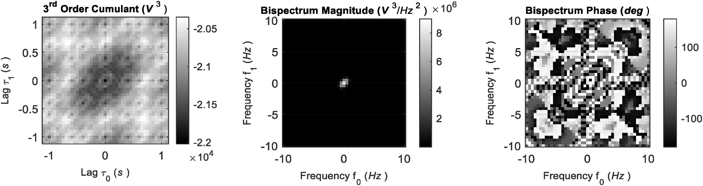
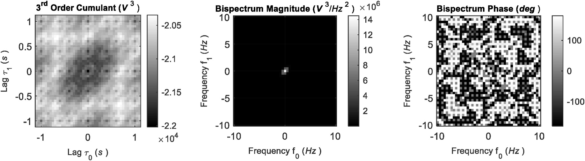
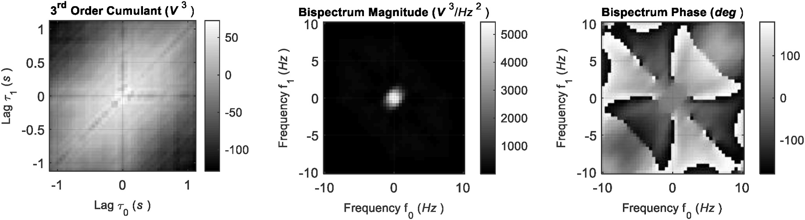

# Memory-based radix-8 FFT power spectral and bispectral estimator

Bit-accurate Python models, a reference RTL implementation, golden test vectors and figures for the estimator of

> A. Khalili Sadaghiani, B. Forouzandeh, *High-performance power spectral/bispectral estimator for biomedical signal
> processing applications using novel memory-based FFT processor*, Integration, the VLSI Journal 99 (2024) 102241.

The design computes a 1024-bin power spectrum from overlapping 512-sample chunks of EEG, EOG or EMG signals with one
memory-based radix-8 FFT, a 6-tap fractional-delay merge of the chunk spectra, a frequency-domain window and a
sum-of-odds squarer, and a direct bispectrum `B(f1, f2) = F(f1) F(f2) F*(f1 + f2)` from the same FFT core.

**Status.** The Python model is tested (69 tests). The RTL is complete but has **never been compiled or simulated**: it
passes a structural lint, and its control logic was checked against the model through a Python transliteration. The
first real test is `make -C sim all` (needs Icarus Verilog). No synthesis, timing or power result exists. The
numbers of the paper are quoted as *paper*; everything measured here is *model* and uses synthetic signals.

| Part | Where | State |
|---|---|---|
| Floating-point references, fixed-point models, schedule model | `python/btpsd/` | tested |
| Reference RTL (rotator, butterfly, FFT core, PSD and bispectrum engines) | `rtl/` | written, lint-clean, unsimulated |
| Testbenches and golden vectors | `tb/`, `sim/` | complete, not yet run |
| Experiments and figures | `results/`, `docs/figures/`, `docs/paper_figures/` | regenerable with `make experiments figures` |
| Notes on the paper (findings, candidate errata) | `docs/PAPER_NOTES.md` | |
| Architecture, arithmetic contract, differences from the paper | `docs/ARCHITECTURE.md` | |

## Quick start

```bash
pip install -r requirements.txt     # numpy, scipy, matplotlib, pytest (tested with numpy 2.5, scipy 1.18, Python 3.13)
make test          # unit tests of the model and of the RTL transliteration
make lint          # structural check of the Verilog
make sim           # RTL testbenches (Icarus Verilog); prints TB_RESULT: PASS/FAIL per testbench
make experiments   # results/*.csv from the models (about half a minute)
make figures       # docs/figures/*
```

```python
import sys; sys.path.insert(0, "python")
from btpsd import estimator as E, bispectrum as B, signals as sg
from btpsd.metrics import sqnr_db

x = sg.pink(20480, seed=0)                                    # synthetic test signal
res = E.psd_fixed(x, E.HwConfig(wl=12, window="hann"))        # bit-accurate hardware model, 12-bit words
print(sqnr_db(E.psd_exact_welch(x, window="hann"), res.to_float()))

x2, _ = sg.qpc(512 * 8, coupled=True, seed=0)                 # quadratic phase coupling at (f1, f2)
re, im, S, shift = B.bispectrum_fixed(x2, B.BispecConfig(wl=12, max_bin=32))
Bxy = B.bispectrum_hw_to_float(re, im, 12, S, shift)          # 32 x 32 bispectrum, analytic scale
```

The Vivado script `fpga/synth_ooc.tcl` (untested) produces out-of-context utilisation and timing reports.

## Results

The two blocks below are never compared digit by digit: the paper's records are not available here, and its SQNR
formula and test signals are not fully specified (`docs/PAPER_NOTES.md`, section 2.3).

**Paper-reported** (Table 9, Artix-7, WL = 10; reproduced here as `data/paper_table9_fpga_comparison.csv`)

| Design | DSP | LUT | FF | Throughput | Frequency | Power | Latency |
|---|---:|---:|---:|---:|---:|---:|---:|
| Proposed estimator | 0 | 4834 | 4420 | 205 Msps (R = 0.88) | 232 MHz | 191 mW | 1252 cycles |

**Measured in this repository** (model on synthetic signals, 5 seeds; `results/`)

| Quantity | Value |
|---|---|
| 512-point FFT, RTL pipeline (rotator 4, butterfly 10, loop latency 12) | 196 issue cycles + 11 = 207 cycles, 4 stall cycles (schedule model; the RTL transliteration gives the same, the RTL itself is unsimulated) |
| Constant-rotator ROM, tolerance 0.01 rad | 129 entries, maximum angle error 0.0097 rad, 7.6 adders per rotation on average, 512-point FFT SNR 46.6 dB at WL = 16 |
| Odd-bin accuracy of the 6-tap merge | 11.7 dB (analytic bound 11.74 dB); Table 3 of the paper reports 50.08 dB |
| PSD SQNR against the exact Welch average, WL = 10 / 12 / 16 | white 15.4 / 23.9 / 23.5 dB; pink 28.4 / 31.9 / 29.0 dB; EEG-like 28.7 / 40.0 / 44.2 dB |
| Bispectrum magnitude SQNR (coupled signal), WL = 10 / 12 / 14 / 16 / 18 | 22.7 / 34.6 / 43.1 / 52.2 / 59.6 dB |
| Serial sum-of-odds squarer, squarer pairs needed for R = 0.88 | 1.0 to 1.6 at WL = 10, 44 to 96 at WL = 16 |

Reading the table: from WL = 14 the PSD SQNR is set by the merge, not by the word length, because six taps keep
about 93 % of the interpolation kernel energy. `docs/PAPER_NOTES.md` explains this, lists what the paper leaves open,
and lists twelve candidate errata with the printed and the expected form.

## Figures

The sheets in `docs/figures/` are drawn by `python/scripts/make_*.py` from the model; the paper's own figures are in
`docs/paper_figures/` (manifest and rights note in that folder's `README.md`).

| | |
|---|---|
|  |  |
| `fig01` system overview | `fig02` memory-based FFT architecture |
|  |  |
| `fig09` conflict-free bank and row map | `fig10` schedule, latency and the pass 0 to 1 stall |
|  |  |
| `fig12` word-length and error budget (model) | `fig13` 2-D bispectrum atlas, three windows (model, synthetic signals) |

Also in `docs/figures/`: `fig03` radix-8 butterfly network, `fig04` segment merge, `fig05` six-tap filter, `fig06`
rotator, `fig07` window, squarer and accumulator, `fig08` bispectrum datapath, `fig11` fractional-delay kernels,
`fig14` bispectrum views (PNG and SVG).

**Bispectra from the paper** (Figs. 24-32, recorded EEG-1, EOG-1 and EMG-1; windows rectangular, Hann, Hamming; click for the full size)

| | Rectangular | Hann | Hamming |
|---|---|---|---|
| EEG-1 | [](docs/paper_figures/paperfig24_bispectrum_eeg1_rectangular.jpg) | [](docs/paper_figures/paperfig25_bispectrum_eeg1_hann.jpg) | [](docs/paper_figures/paperfig26_bispectrum_eeg1_hamming.jpg) |
| EOG-1 | [](docs/paper_figures/paperfig27_bispectrum_eog1_rectangular.jpg) | [](docs/paper_figures/paperfig28_bispectrum_eog1_hann.jpg) | [](docs/paper_figures/paperfig29_bispectrum_eog1_hamming.jpg) |
| EMG-1 | [](docs/paper_figures/paperfig30_bispectrum_emg1_rectangular.jpg) | [](docs/paper_figures/paperfig31_bispectrum_emg1_hann.jpg) | [](docs/paper_figures/paperfig32_bispectrum_emg1_hamming.jpg) |

## Repository layout

```text
python/btpsd/        models: fixedpoint, windows, fdfilter, reference (Welch), cordic (rotator ROM), r8fft + schedule,
                     squarer, estimator (PSD), bispectrum, rtlmodel (transliteration of the RTL), vectors, signals,
                     metrics, paperdata, viz
python/tests/        69 unit tests
python/scripts/      run_experiments, make_diagrams_a/b/c, make_plots, gen_cru_rom, gen_rtl, gen_vectors
rtl/                 Verilog-2001 reference implementation (see rtl/README.md)
tb/                  six self-checking testbenches
sim/                 Makefile for Icarus Verilog, golden vectors (sim/vectors, see its README.md)
scripts/lint_rtl.py  structural check of the Verilog sources
fpga/                out-of-context Vivado synthesis script (untested)
data/                values reported by the paper (paper_*.csv, table6_printed.csv) and generated ROM tables
results/             model experiments with provenance.json
docs/                ARCHITECTURE.md, PAPER_NOTES.md, figures/, paper_figures/
```

The previous contents of `rtl/` and the ROM generator scripts were replaced by the sources listed in `rtl/README.md`;
they remain available in the git history.

## Further reading

1. `docs/ARCHITECTURE.md` - dataflow, arithmetic contract shared by model and RTL, FFT schedule, differences from the
   paper's overlapped design, verification map.
2. `docs/PAPER_NOTES.md` - findings on the paper's claims, SQNR definitions, squarer throughput, candidate errata.
3. `rtl/README.md`, `sim/vectors/README.md` - RTL files, parameters, vector formats.
