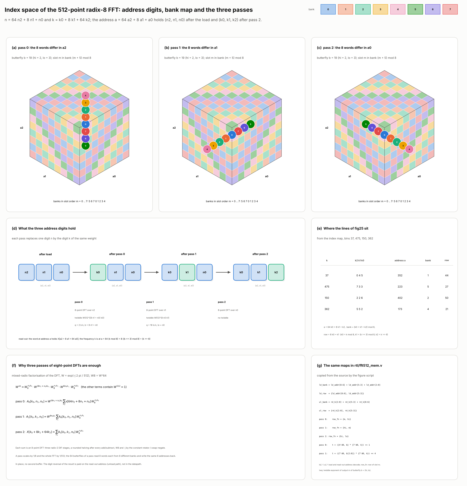
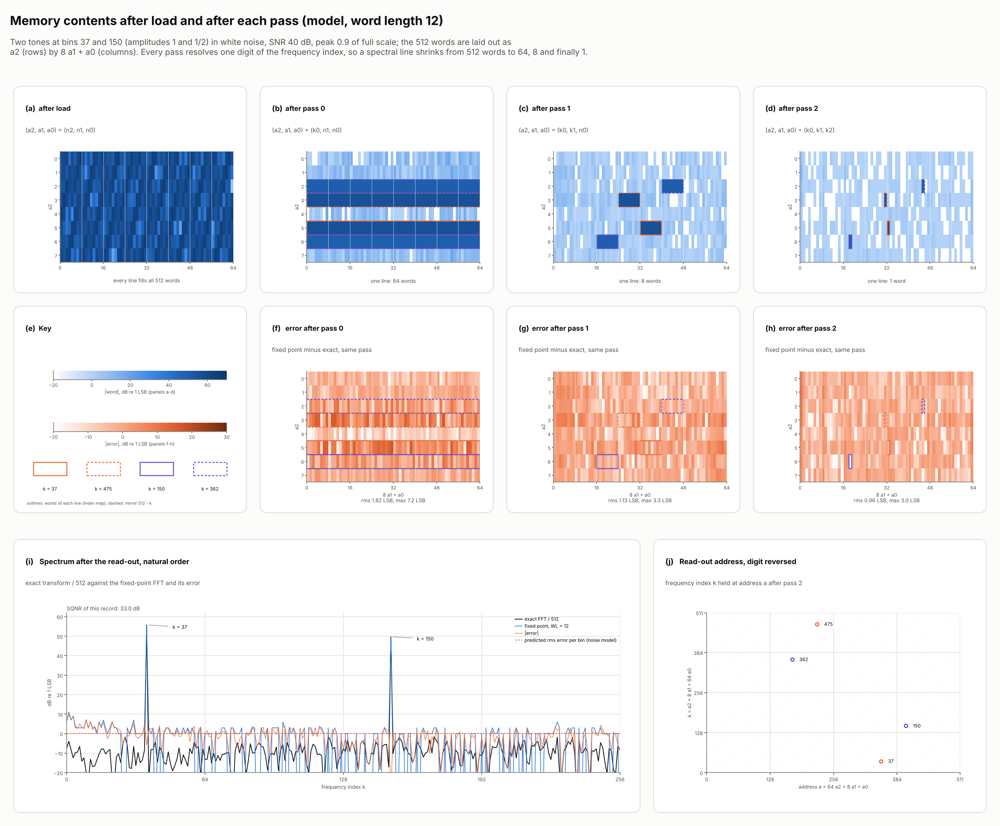
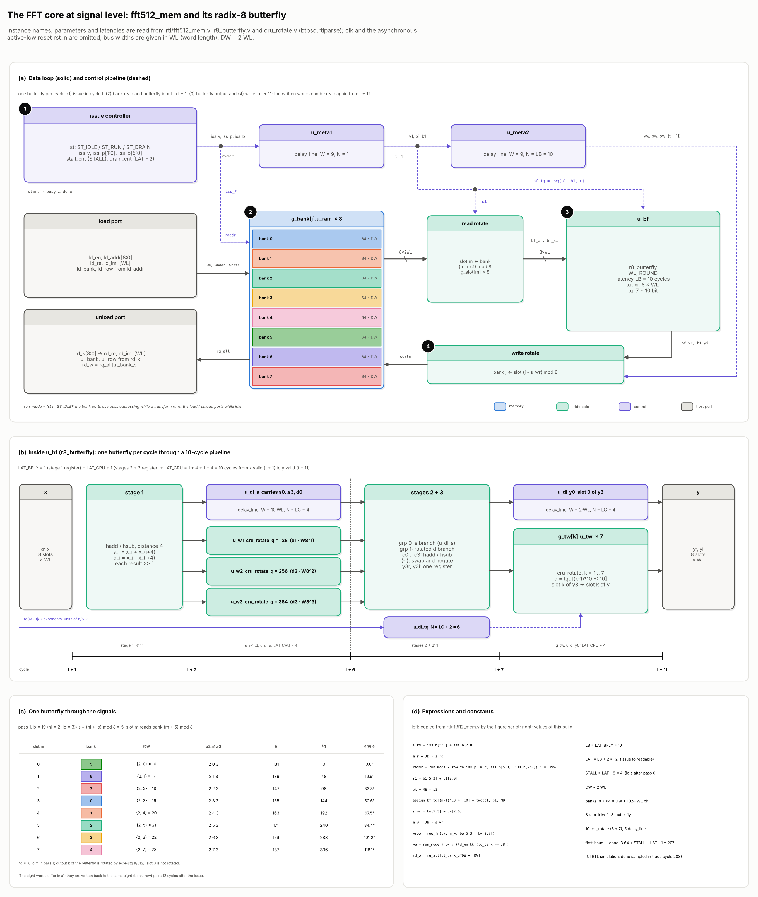
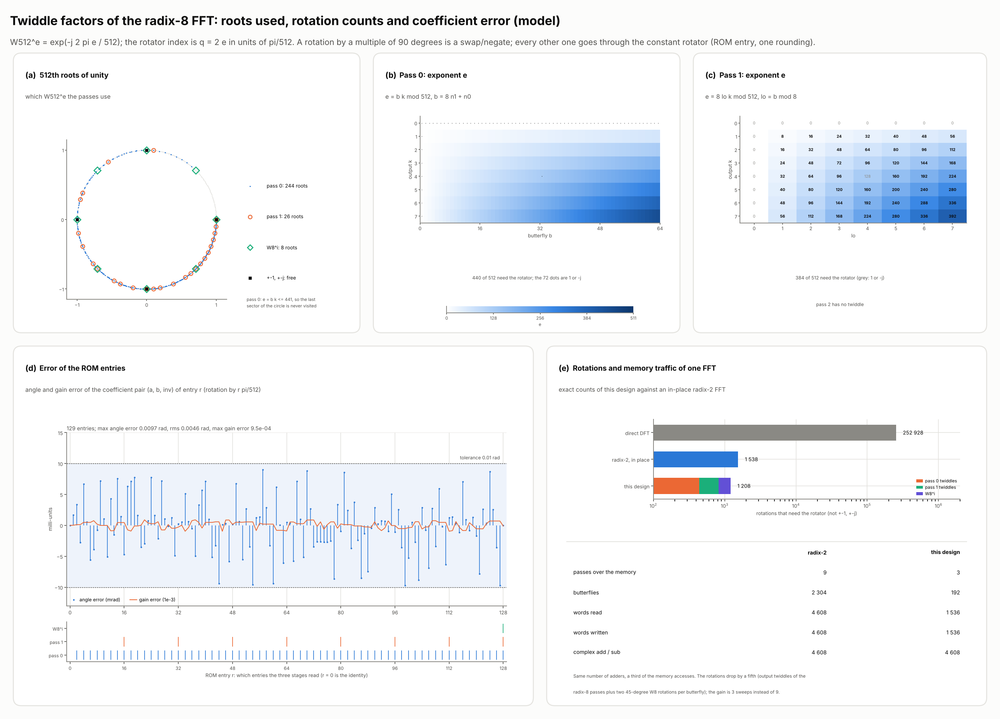
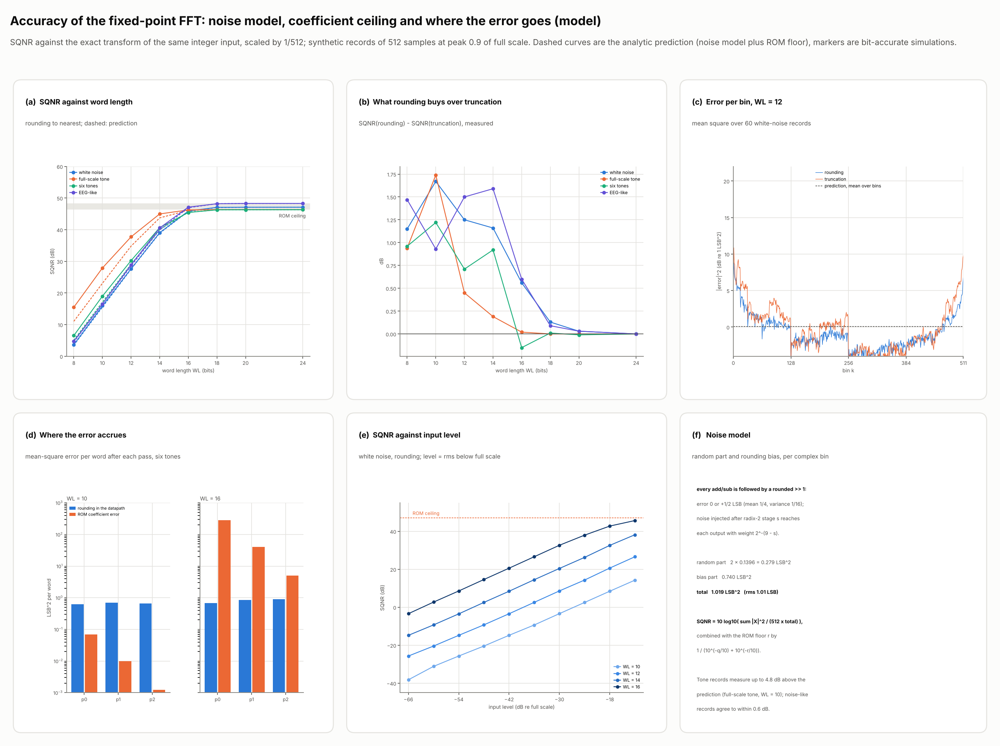

# The 512-point memory-based FFT

How the transform at the centre of both estimators works, from the mathematics down to the signals of the Verilog.
Every number below is computed by the models in `python/btpsd` on synthetic signals, read from the sources in `rtl/`, or
taken from the cycle traces of the CI simulation; nothing is a value reported in the paper unless it is marked *paper*,
and nothing is measured on hardware (the RTL is simulated with Icarus Verilog, not synthesised).

| Sheet | Shows | Generator | Based on |
|---|---|---|---|
|  | `fig24` index cubes, address digits, bank map, factorisation | `make_fft_figures.py` | model, Verilog |
|  | `fig25` memory contents after load and after each pass | `make_fft_figures.py` | model |
|  | `fig26` block diagram at signal level, butterfly pipeline, one butterfly's signals | `make_fft_figures.py` | Verilog, model, simulation |
|  | `fig27` twiddle factors, rotation counts, ROM coefficient error | `make_fft_figures.py` | model |
|  | `fig28` accuracy against word length, rounding, per-pass error | `make_fft_figures.py` | model |

Earlier sheets that draw the same machine from other angles: `fig02` (loop), `fig03` (butterfly network), `fig06`
(rotator), `fig09` (bank map), `fig10` (schedule), `fig15` to `fig18` (hierarchy, state machines, pipeline timing).
`python/tests/test_fft_study.py` and `python/tests/test_fft_sheets.py` tie the numbers and structures printed on the
sheets to the model and to the Verilog.

---

## 1. The transform and why three passes are enough

The estimators need the 512-point DFT

```
X[k] = sum_{n=0}^{511} x[n] W^(n k),        W = exp(-j 2 pi / 512)
```

and the cores compute `X[k] / 512`: every radix-2 add or subtract is followed by a rounded halving (section 4), so the
word length never grows and no block floating point is needed. A radix-8 butterfly therefore scales by 1/8, a pass by
1/8 and the transform by 1/512.

**Cost of the alternatives** (`fftstudy.rotation_counts`, `operation_counts`; a rotation is *non-trivial* if it is not a
multiple of 90 degrees, which is a swap and negate):

| | direct DFT | in-place radix-2 DIF | this design (radix 8) |
|---|---:|---:|---:|
| butterflies | | 2 304 (9 stages of 256) | 192 (3 passes of 64) |
| complex add / subtract | | 4 608 | 4 608 |
| non-trivial rotations | 252 928 | 1 538 | 1 208 (824 twiddles + 384 `W8^i`) |
| memory words read (and written) | | 4 608 | 1 536 |
| sweeps through the memory | | 9 | 3 |

The adder count is the same as for radix 2 (a radix-8 butterfly is three radix-2 stages), the rotations are 21 % fewer,
and the memory is touched a third as often: the machine reads eight words per cycle instead of two.

**Index maps.** Write the time index as `n = 64 n2 + 8 n1 + n0` and the frequency index as `k = k0 + 8 k1 + 64 k2`, every
digit in `0..7`. Since `W^512 = 1` and `W8 = W^64 = exp(-j pi / 4)`, the product `n k` splits into five terms

```
W^(nk) = W8^(n2 k0) · W^((8 n1 + n0) k0) · W8^(n1 k1) · W^(8 n0 k1) · W8^(n0 k2)
```

(the identity is checked for all 512 x 512 pairs in `test_fft_sheets.py`). Reading it from the left gives three passes of
8-point DFTs:

| Pass | Computes | Twiddle on output `k0` / `k1` | Exponent `e` of `W^e` |
|---|---|---|---|
| 0 | `A0[k0, n1, n0] = W^((8 n1 + n0) k0) · sum_{n2} x[64 n2 + 8 n1 + n0] W8^(n2 k0)` | yes | `b k`, `b = 8 n1 + n0` |
| 1 | `A1[k0, k1, n0] = W^(8 n0 k1) · sum_{n1} A0[k0, n1, n0] W8^(n1 k1)` | yes | `8 lo k`, `lo = n0` |
| 2 | `X[k0 + 8 k1 + 64 k2] = sum_{n0} A1[k0, k1, n0] W8^(n0 k2)` | none | |

Each sum is an 8-point DFT: three radix-2 decimation-in-frequency stages. The twiddle is applied to the *outputs* of the
8-point DFT; in the hardware's units (multiples of pi/512) the rotator index is `q = 2 e`.

---

## 2. Where the data sits: eight banks and one address map (`fig24`)

The 512 complex words live in eight 64-word banks. A word's address is `a = 64 a2 + 8 a1 + a0` and its home is

```
bank = (a2 + a1 + a0) mod 8,        row = 8 a2 + a1
```

The three digits of the address hold different things as the transform proceeds:

| | `a2` | `a1` | `a0` |
|---|---|---|---|
| after load | `n2` | `n1` | `n0` |
| after pass 0 | **`k0`** | `n1` | `n0` |
| after pass 1 | `k0` | **`k1`** | `n0` |
| after pass 2 | `k0` | `k1` | **`k2`** |

Pass `p` combines the eight words that differ in one digit (`a2`, `a1`, `a0` for `p = 0, 1, 2`). Because they differ in
exactly one digit, their digit sums differ mod 8 and so the eight words sit in eight different banks: they can all be read
in one cycle, and written back to the same eight addresses afterwards (in place, no second buffer). `fig24` draws the 8 x 8 x 8
index cube with the bank as colour and one butterfly as a line through it, one cube per pass; `tests/test_fft_sheets.py`
checks the isometric drawing tiles its hexagon and that the drawn fibres are the schedule of `btpsd.schedule`.

**Butterfly `b = 8 hi + lo`, slot `m`.** The word of slot `m` is in bank `(m + hi + lo) mod 8`, at row `{m, hi}` in pass 0,
`{hi, m}` in pass 1 and `{hi, lo}` in pass 2 (`{x, y}` is the concatenation `8 x + y`). A rotation `s = (hi + lo) mod 8`
therefore routes bank `(m + s) mod 8` to slot `m`: that is all the crossbar in front of the butterfly has to do.

**Worked example** (pass 1, `b = 19`, `hi = 2`, `lo = 3`, `s = 5`): the words are at addresses 131, 139, ..., 187
(`a2 = 2`, `a0 = 3`, `a1 = m`), in banks 5, 6, 7, 0, 1, 2, 3, 4 for slots 0 to 7, at rows 16 to 23. Their twiddle exponents are
`16 lo m = 48 m` units of pi/512, i.e. rotations of 0, 16.9, 33.8, ... 118.1 degrees (`fig26` (c)).

**Where the result is.** After pass 2 the word at address `(a2, a1, a0)` is `X[a2 + 8 a1 + 64 a0]`: the output is in digit-reversed
order. The reversal is paid on the read-out address, not in the datapath: frequency `k` is at
`a = 64 (k mod 8) + 8 ((k >> 3) mod 8) + (k >> 6)`, which is what `ul_bank` and `ul_row` compute from `rd_k`. A tone at bin 37
(`k0 = 5, k1 = 4, k2 = 0`) ends at address 352, bank 1, row 44.

---

## 3. Memory contents pass by pass (`fig25`)

`fig25` runs a record with two tones (bins 37 and 150, amplitudes 1 and 1/2, 40 dB SNR, peak 0.9 of full scale) through
the fixed-point model at word length 12 and shows the 512 words as an 8 x 64 array (`a2` by `8 a1 + a0`) after the load and
after each pass, as magnitude in dB and as the error against the exact floating-point transform of the same pass.

Every pass resolves one digit of the frequency index, so a spectral line shrinks from 512 words after the load to **64**
words (those with `a2 = k0`) after pass 0, **8** words (`a2 = k0`, `a1 = k1`) after pass 1 and a **single** word after pass 2.
The outlines on the sheet mark these cells for the two lines and their mirror bins 475 and 362; the test
`test_marked_cells_are_exactly_where_the_tone_sits` checks, for pure tones, that the marked cells are exactly the non-zero
ones of the exact snapshots.

---

## 4. The butterfly and the rotator (`rtl/r8_butterfly.v`, `rtl/cru_rotate.v`; `fig03`, `fig06`, `fig26` (b))

**Arithmetic contract.** Words have `WL` bits. Every radix-2 add or subtract is followed by one right shift:
`(a ± b + 1) >> 1` with rounding (`ROUND = 1`, half up) or `(a ± b) >> 1` without (`ROUND = 0`), clamped to `WL` bits (only the
difference of the two extreme codes can leave the range, by one code). The error of one halving is 0 or +1/2 LSB (rounding;
−1/2 for truncation) with probability 1/2 each, variance 1/16 LSB², in both modes. The `-j` of the butterfly is a swap with
a negation that saturates the single overflow case.

**Three stages and the rotations** (the 8-point DFT in decimation-in-frequency form):

| Stage | Distance | Operation | Rotations |
|---|---|---|---|
| 1 | 4 | `s_i = x_i + x_(i+4)`, `d_i = x_i - x_(i+4)` for `i = 0..3` (each >> 1) | `d_i *= W8^i`: `u_w1`, `u_w2`, `u_w3` at `q = 128, 256, 384` (`d_0` waits) |
| 2 | 2 | per group of four `g`: `c0 = g0 + g2`, `c2 = g0 - g2`, `c1 = g1 + g3`, `c3 = (-j)(g1 - g3)` | |
| 3 | 1 | `y[slot] = c0 + c1`, `y[slot+4] = c0 - c1`, `y[slot+2] = c2 + c3`, `y[slot+6] = c2 - c3` | |
| output | | `Y[k] *= exp(-j tq[k] pi/512)` for `k = 1..7` | `g_tw[k].u_tw`, `tq` from the control logic |

The `s` group (even outputs) and the rotated `d` group (odd outputs) go through stages 2 and 3 side by side, in one register
stage. Slot 0 is never rotated; it is delayed (`u_dl_y0`) to stay aligned with the others.

**The rotator** (`cru_rotate`, four register stages, one rotation per cycle, `y = x exp(-j q pi/512)`): (1) octant
reduction, `quad = q[9:8]` and, if the remainder `r = q[7:0]` exceeds 128, `quad += 1` and `r = 256 - r` (the reduced angle
stays within one octant, so `r = 0..128`), and the ROM lookup of the coefficient triple `(a, b, inv)` of `r`; (2) the
rotation by the integer pair, `yr = xr a ± xi b`, `yi = xi a ∓ xr b` (the sign follows the direction of the reduced angle);
(3) the gain correction `* inv >> 14` with one rounding; (4) the quadrant `(-j)^quad` (a swap and negate, free) and the
saturation.
The ROM has 129 entries for a tolerance of 0.01 rad (largest angle error 0.0097 rad, `results/cru_rom_tradeoff.csv`);
the 512-point FFT only reads **64 of the 128 non-identity entries**, all of them even-numbered, because every twiddle
exponent of the passes and the `W8^i` are even multiples of pi/512 (`fig27`, `test_used_rom_entries_are_even_and_few`).

---

## 5. Control and timing (`rtl/fft512_mem.v`; `fig16`, `fig18`, `fig26`)

**Issue controller.** Three states, `ST_IDLE`, `ST_RUN`, `ST_DRAIN`. On `start` it issues butterfly `iss_b` of pass `iss_p` in
every cycle (`iss_v` high): 64 butterflies of pass 0, then **`STALL` idle cycles**, 64 of pass 1, 64 of pass 2. It then
drains (`drain_cnt` counts down from `LAT - 2`) and pulses `done` for one cycle.

**Latencies.** `LAT_CRU = 4`; the butterfly is `LAT_BFLY = 1 + LAT_CRU + 1 + LAT_CRU = 10` cycles from its input to its
output (stage 1 register, rotator, stages 2 + 3 register, rotator); the write-back adds the synchronous bank read and the
write: `LAT = LAT_BFLY + 2 = 12` cycles from the issue of a butterfly to the first cycle in which the words it wrote can be read
again.

**The one hazard.** The first butterfly of pass 1 needs the words written by butterflies 0, 8, ..., 56 of pass 0. The
last of them is issued in cycle 56 and readable from cycle `56 + LAT`, so pass 1 cannot start before that instead of
at 64: `STALL = max(0, LAT - 8) = 4`. There is no other hazard; with one cycle less the transform is wrong
(`docs/ARCHITECTURE.md` section 3, `fig10`, `fig18`).

```
issue slots = 3 · 64 + STALL = 196         first issue -> done = issue slots + LAT - 1 = 207 cycles
```

207 cycles is the model's `schedule_cycles` and `Fft512Rtl.run`, and the count of `tb/tb_fft512_mem.v`; in the CI trace
(`results/rtl_trace_fft512.csv`, cycle 0 = `start` high) the first issue is sampled in cycle 1 and `done` in cycle 208.

**The life of one butterfly** (cycle `t` = its issue):

| Cycle | What happens | Signals |
|---|---|---|
| `t` | the controller presents the butterfly; every bank forms its read row | `iss_v, iss_p, iss_b`; `raddr = row_fn(iss_p, m_r, hi, lo)`, `m_r = j - s_rd` |
| `t + 1` | the banks deliver their words; the read rotation puts bank `(m + s1) mod 8` into slot `m`; the twiddle exponents are formed | `rq_all`, `v1, p1, b1`, `s1`, `bf_xr, bf_xi`, `bf_tq` |
| `t + 2` | stage 1 registered | `s1r, s1i, d1r, d1i` |
| `t + 2 .. t + 6` | `d1, d2, d3` through the rotators `u_w1..3`; `s` and `d0` wait in `u_dl_s`; `tq` waits in `u_dl_tq` | |
| `t + 7` | stages 2 + 3 registered | `y3r, y3i` |
| `t + 7 .. t + 11` | slots 1..7 through `g_tw[k].u_tw`; slot 0 waits in `u_dl_y0` | |
| `t + 11` | butterfly output; the delayed control reaches the write side; the write happens at the end of this cycle | `bf_yr, bf_yi`, `vw, pw, bw`, `we = vw`, `waddr = row_fn(pw, m_w, ...)` |
| `t + 12` | the written words can be read again | |

---

## 6. Reading the block diagram (`fig26`)

**(a) Data loop and control pipeline.** The solid path is the data loop of `fig02` with the real names. A butterfly
(1) is issued, (2) read from the eight banks `g_bank[j].u_ram` (`ram_1r1w`, 64 words of `DW = 2 WL` bits, one write and one
read port each) and rotated into slot order by the read crossbar (`g_slot[m]`), (3) transformed by `u_bf` (`r8_butterfly`), and
(4) written back through the write rotation (`bank j <- slot (j - s_wr) mod 8`). The dashed path is the control pipeline:
the issue controller's `iss_*` go straight to the read addresses, through `u_meta1` (1 cycle) to the read rotation and the
twiddle logic, and through `u_meta2` (`LB = 10` cycles) to the write side, so the write arrives exactly when the butterfly
output does. While the core is idle (`run_mode = st != ST_IDLE` low) the bank ports belong to the host: `ld_*` writes a
sample at its natural address and `rd_k` reads a frequency bin through the digit-reversed unload address.

**(b) Inside `u_bf`.** The 10-cycle pipeline with the instances of `r8_butterfly.v`: stage 1, the three `W8^i` rotators next
to `u_dl_s` (which carries the sums and `d0` for `LC = 4` cycles), stages 2 + 3, the seven twiddle rotators `g_tw[k].u_tw` next to
`u_dl_y0`, and `u_dl_tq` delaying the twiddle exponents by `LC + 2 = 6` cycles to meet the data at `y3`. The axis shows the
cycle at which each register or rotator output is valid, relative to the issue.

**(c) One butterfly through the signals.** The table of section 2 for pass 1, `b = 19`: bank, row, address digits, address,
twiddle exponent and angle for each slot, computed by `fftstudy.butterfly_signals` and checked against `btpsd.schedule`.

**(d) Expressions and constants.** The address and select expressions copied from `rtl/fft512_mem.v` by the figure script
(`test_copied_load_and_unload_maps_compute_the_schedule_maps` evaluates the load and unload maps for all 512 addresses), and
the constants of the build: `LB`, `LAT`, `STALL`, the storage (8 x 64 x `DW` = 1024 `WL` bits: 16.0 kbit at `WL = 16`), the
instance counts (8 `ram_1r1w`, 1 `r8_butterfly`, 10 `cru_rotate`, 5 `delay_line`) and the 207 cycles.

The figure script asserts its own drawing against the Verilog (`core_facts` in `make_fft_figures.py`): instance names and
counts, the parameters of `u_meta1/2` and the delay lines, the `q` of the three `W8^i` rotators, the formulas of `LAT` and
`STALL`, and the agreement of the cycle budget with the CI trace. A renamed instance or a changed latency fails the figure
build rather than leaving a stale picture.

---

## 7. Twiddle factors and rotation counts (`fig27`)

Of the 512 pass-0 twiddles, 440 need the rotator (the other 72 are 1 or `-j`); of the 512 pass-1 twiddles 384 do (the rest are
1 or `-j`); pass 2 has none; and the two 45-degree `W8^i` of each butterfly add 384, giving the 1 208 of section 1. Pass 0 uses
`e = b k <= 441`, so the last sector of the unit circle (exponents 442 to 511) is never visited; the passes use 244 and 26
distinct roots (`twiddle_exponents_used`). `fig27` also plots the angle and gain error of each ROM entry against the
0.01 rad tolerance.

---

## 8. Accuracy of the fixed-point FFT (`fig28`, `results/model_fft_accuracy.csv`)

**Definition.** SQNR = `10 log10( sum |X_ref|^2 / sum |X - X_ref|^2 )`, with `X_ref` the exact transform of the same integer
input scaled by 1/512 and `X` the output of the bit-exact model (`fftstudy.fft_sqnr`). Inputs are quantised real records
with a peak of 0.9 of full scale: white noise, a tone at bin 37, six tones at random bins, and a synthetic EEG-like
signal (`btpsd/signals.py`); one seed each.

| `WL` | 8 | 10 | 12 | 14 | 16 | 18 | 24 | coefficient error alone |
|---|---:|---:|---:|---:|---:|---:|---:|---:|
| white noise | 3.7 | 15.9 | 27.7 | 39.1 | 45.9 | 47.1 | 47.1 | 47.1 |
| full-scale tone | 15.5 | 27.9 | 37.7 | 45.0 | 46.2 | 46.4 | 46.4 | 46.4 |
| six tones | 6.5 | 19.0 | 30.2 | 40.7 | 45.4 | 46.3 | 46.3 | 46.3 |
| EEG-like | 4.8 | 16.6 | 28.9 | 40.6 | 47.1 | 48.2 | 48.3 | 48.3 |

(dB, rounding to nearest, ROM tolerance 0.01 rad; "coefficient error alone" is the floating-point FFT with the ROM
coefficients against the exact one and does not depend on `WL`.)

What the table and the sheet show:

* **Two regimes.** Up to about `WL = 14` the SQNR gains close to 6 dB per bit (white noise: 3.7, 15.9, 27.7, 39.1 dB for
  `WL` = 8, 10, 12, 14); beyond `WL = 16` it saturates at the **coefficient-error ceiling** of the rotator ROM, 46 to 48 dB
  for this tolerance. A longer word does not help unless the ROM tolerance is tightened (`results/cru_rom_tradeoff.csv`).
* **Rounding against truncation** (SQNR of rounding minus SQNR of truncation) lies between -0.15 and +1.74 dB over the 32
  input and word-length pairs: largest for the full-scale tone at `WL = 10` (1.74 dB), between -0.15 and 0.60 dB for
  `WL >= 16` and between -0.01 and 0.13 dB for `WL >= 18`. The halvings contribute the same variance in both modes and a
  bias of the same size and opposite sign (+1/4 LSB rounding, -1/4 LSB truncation per real component).
* **Noise model.** The analytic prediction of `fftstudy.predicted_sqnr` (an estimate, not a measurement) uses the nine
  halvings (random part 0.140 LSB² per real component) and a bias term (an upper estimate, 0.74 LSB² per complex bin) and
  agrees with the simulation to within 0.41 dB for white noise and 0.62 dB for the EEG-like signal at `WL` = 10, 12, 14
  (white noise: 15.95, 27.66, 39.06 dB measured against 15.54, 27.54, 38.91 predicted). Over the 32 rounding cases the
  measured SQNR is never more than 0.08 dB below the prediction and up to 4.84 dB above it (full-scale tone, `WL = 10`); the
  tone records are the cases the noise-like model does not describe.
* **Where the error comes from.** `pass_error_power` splits the error after each pass into the rotator coefficient part and
  the rounding of the datapath; `fig28` draws the split for `WL` = 10 and 16 and the per-bin error floor.

---

## 9. Reproduce and check

```bash
python3 python/scripts/make_fft_figures.py        # fig24 .. fig28 and results/model_fft_accuracy.csv (about 10 s)
python3 -m pytest python/tests/test_fft_study.py python/tests/test_fft_sheets.py python/tests/test_rtlparse_ports.py
make figures                                       # all sheets
```

| What | Where |
|---|---|
| model of the transform, snapshots, counts, noise model | `python/btpsd/fftstudy.py` (data), `r8fft.py`, `schedule.py`, `cordic.py` |
| address maps and latency constants of the RTL in Python | `python/btpsd/rtlmodel.py` (`row_fn`, `twq`, `Fft512Rtl`) |
| structure read from the Verilog | `python/btpsd/rtlparse.py` (`parse_all`, `ports`, `default_parameters`) |
| bit-exact simulation of the Verilog against the model | `tb/tb_fft512_mem.v`, `tb/tb_r8_butterfly.v`, `tb/tb_cru_rotate.v` (CI job `rtl-sim`) |

---

## 10. What is and is not established

* The model and the Verilog follow one contract: the Verilog is simulated bit-exactly against the model for 4 chunks at
  `WL = 16` and, in the top levels, for the configuration matrix (`docs/ARCHITECTURE.md` section 7). The Verilog is **not
  synthesised**; no frequency, resource or power figure follows from anything on these sheets.
* The accuracy numbers are for the synthetic records named above, one seed each, and for the ROM generated for 0.01 rad. They
  are not the paper's results, and records of real signals were not used.
* The 207 cycles are the schedule of this reference core (one butterfly per cycle, a stall of 4). The architecture of the paper
  differs in its memory organisation and scheduling (`docs/ARCHITECTURE.md` section 6); the equivalence of the two is not claimed.
