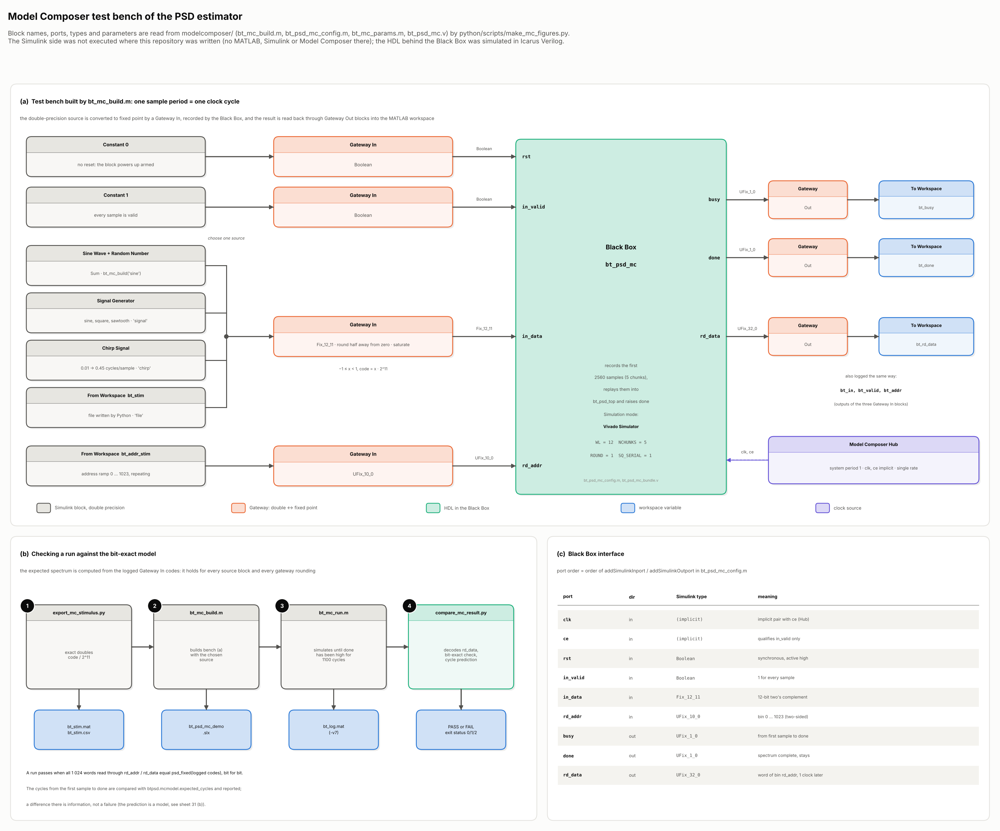
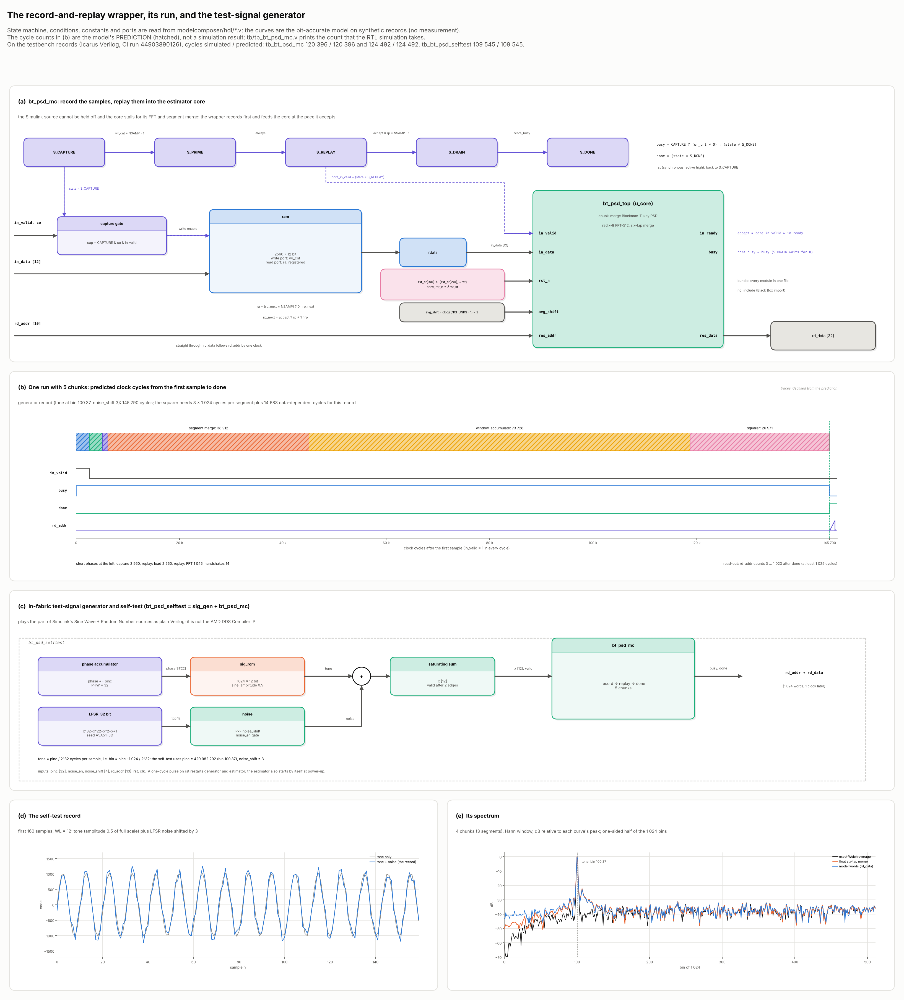

# Model Composer and test-signal generators

How to drive the PSD estimator from Simulink signal sources inside AMD's model-based flow (Vitis Model Composer, formerly
System Generator for DSP) and, without MATLAB, from a signal generator inside the FPGA fabric. The estimator is the same
bit-exact design as everywhere else in this repository (`rtl/bt_psd_top.v`); this pack adds a wrapper, a generator and test
benches around it. Every number below is computed by the models in `python/btpsd`, read from the sources in `rtl/` and
`modelcomposer/`, or (where a table says so) printed by the CI simulation. Nothing is a value reported in the paper and
nothing is measured on hardware. The clock-cycle counts of section 8 are predictions of the model, shown next to the counts
that the RTL simulation printed.

| Sheet | Shows | Generator | Based on |
|---|---|---|---|
|  | `fig30` the Simulink bench, how a run is checked, the Black Box interface | `make_mc_figures.py` | MATLAB source, Verilog, model |
|  | `fig31` the record-and-replay wrapper, the predicted timeline of one run, the in-fabric generator and its spectrum | `make_mc_figures.py` | Verilog, model |

**What has been run.**

| Part | How it was checked |
|---|---|
| Verilog: wrapper, bundle, generator, self-test | testbenches against the bit-exact Python model with Icarus Verilog (`make -C sim mc mcb sg st`, part of `make -C sim all` in the CI workflow) |
| Python: `gen_mc.py`, `export_mc_stimulus.py`, `compare_mc_result.py`, the models | pytest (section 9) |
| MATLAB: `bt_mc_build.m`, `bt_mc_run.m`, `bt_psd_mc_config.m` | **not executed**: there is no MATLAB, Simulink, Model Composer or Vivado where this repository was written; static checks of syntax and of agreement with the Verilog and the Python tools only |
| `sim/xsim_smoke.sh` (Vivado simulator) | **not executed**, same reason |
| DDS Compiler recipe (section 6.3) | documentation only |

---

## 1. What the pack contains

A Model Composer design gets test signals in two ways. Simulink source blocks (Signal Generator, Sine Wave, Random Number,
Chirp Signal, From Workspace) compute double-precision values on the Simulink side, and a *Gateway In* block turns them into
the fixed-point signals of the HDL part. IP blocks of the HDL blockset (Sine Wave, DDS Compiler) generate the signal inside the
HDL part. The pack covers both: the bench of `bt_mc_build.m` uses the Simulink sources, `sig_gen.v` is a small synthesisable
generator that does what Sine Wave plus Random Number do, inside the fabric, and section 6.3 says how the AMD DDS Compiler would
be used instead.

| File | Role |
|---|---|
| `modelcomposer/hdl/bt_psd_mc.v` | Black Box wrapper: records the samples, replays them into `bt_psd_top`, raises `done` (section 3) |
| `modelcomposer/hdl/bt_psd_mc_bundle.v` | the wrapper and every module it needs in one file, header macros expanded, no `include`: the file the Black Box compiles (generated) |
| `modelcomposer/hdl/sig_gen.v`, `sig_rom.v` | test-signal generator: phase accumulator, 1 024-entry sine table, 32-bit LFSR noise (section 7); `sig_rom.v` is generated |
| `modelcomposer/hdl/bt_psd_selftest.v` | generator + wrapper: the estimator on a generated tone without Simulink |
| `modelcomposer/matlab/bt_psd_mc_config.m` | Black Box configuration function: language, entity, ports, types, clock and clock enable, HDL file (generated) |
| `modelcomposer/matlab/bt_mc_params.m` | word length, chunks, segments, averaging shift, widths and power scale of the build as a struct (generated) |
| `modelcomposer/matlab/bt_mc_build.m` | builds the Simulink bench (section 4) |
| `modelcomposer/matlab/bt_mc_run.m` | simulates it, saves the logs, calls the checker (section 5) |
| `python/scripts/gen_mc.py` | writes the four generated files from the Verilog sources |
| `python/scripts/export_mc_stimulus.py` | writes a synthetic stimulus (`.mat`, `.csv`, `.json` with the expected spectrum words) |
| `python/scripts/compare_mc_result.py` | checks a logged run against the bit-exact model |
| `python/btpsd/mcmodel.py`, `siggen.py` | the bit-exact models of the wrapper's result and cycle count, and of the generator |
| `tb/tb_bt_psd_mc.v`, `tb_sig_gen.v`, `tb_bt_psd_selftest.v` | self-checking testbenches (golden vectors `sim/vectors/siggen_wl12*`, `selftest_wl12*`) |

The files marked *generated* are produced by `gen_mc.py` and checked for being current by `python/tests/test_gen_mc.py`; the
committed ones are those of the default build: word length 12, five chunks, rounding to nearest, serial squarer.
`modelcomposer/stimulus/` and `modelcomposer/work/` receive what a run writes and are ignored by git.

## 2. Requirements and starting Model Composer

**Simulink route (sections 4 to 6).**

* AMD Vivado and Vitis, and Vitis Model Composer, which is licensed as an add-on to them.
* MATLAB and Simulink at a release that your Vitis version supports. AMD decides this per release (UG1483, "Supported MATLAB
  Versions and Operating Systems"). For orientation, the MathWorks support page lists R2024b and R2024a for Vitis 2025.1 and
  R2024a, R2023b and R2023a for Vitis 2024.2; read the guide of the release you installed. The operating-system list of
  Model Composer is separate from the one of Vivado (UG973 points to UG1498 for it).
* Python 3 with numpy and scipy for the tools of this repository (MATLAB calls `compare_mc_result.py` through the system shell).

Starting it on Linux, with the paths of the 2025.2 layout (earlier guides name `<install_dir>/Model_Composer/<version>`, and the
2020.2 launcher was `xmc_sysgen`; follow UG1483 for your release):

```bash
# once after the installation, Ubuntu and RHEL 9 only; UG1483 says it needs sudo access
model_composer -configlib

# every session: put Vitis and Model Composer on the path, then start MATLAB through Model Composer
source <install_dir>/<version>/Vitis/settings64.sh
source <install_dir>/<version>/Model_Composer/settings64.sh
model_composer
```

`bt_mc_build.m` begins by loading the library `xbsIndex_r4` (the HDL blockset) and stops with a message if MATLAB was not started
through Model Composer.

**Vivado-only route (section 7).** Vivado (xsim) or Icarus Verilog, and Python for the expected values. No MATLAB.

## 3. The Black Box: why it records and replays (`fig31` (a))

`bt_psd_top` takes its samples through a ready/valid handshake and holds the producer off while it computes: after every
512-sample chunk it runs the 512-point FFT and, from the second chunk on, merges the new chunk with the previous one into a
1 024-point spectrum (`fig16`, `fig20`). A Simulink source cannot be held off, it emits one sample per sample period, and a
Black Box has no back-pressure port. `bt_psd_mc` therefore records the first `NCHUNKS * 512` samples that arrive with
`in_valid` high into a RAM, replays them into `bt_psd_top` at the pace the core accepts them, and raises `done` when the
accumulated spectrum is complete.

```
rst --> CAPTURE --(NSAMP samples seen)--> PRIME --> REPLAY --(last sample accepted)--> DRAIN --(core idle)--> DONE
         in_valid & ce write the RAM        1 cycle   core in_valid, core in_ready       core busy              rd_addr / rd_data
```

| Port | Direction | Type at the block | Meaning |
|---|---|---|---|
| `rst` | in | Boolean | synchronous reset, active high; a one-cycle pulse re-arms the block, a constant 0 serves for one run |
| `in_valid` | in | Boolean | 1 for every sample of the record; samples that arrive while the block is not capturing are ignored |
| `in_data` | in | `Fix_12_11` | sample, two's complement, -1 <= x < 1 |
| `rd_addr` | in | `UFix_10_0` | bin to read, 0 to 1023 (two-sided spectrum) |
| `busy` | out | `UFix_1_0` | 1 from the first captured sample until `done` |
| `done` | out | `UFix_1_0` | 1 while the spectrum is complete and readable; stays until the next `rst` |
| `rd_data` | out | `UFix_32_0` | accumulated, shifted power of bin `rd_addr`, valid while `done` = 1, one clock cycle after `rd_addr` |

`clk` and `ce` are not Simulink ports: the Black Box machinery connects them to the system clock and clock enable
(`addClkCEPair` in `bt_psd_mc_config.m`). The widths follow the build: `in_data` has `WL` bits, `rd_data` has `2 WL + 8`.

* **Single rate.** `ce` qualifies `in_valid` only; the replay and the estimator run on every clock edge, so the block belongs in
  a design with one sample period.
* **Number of segments and averaging.** The record of `NCHUNKS` chunks gives `S = NCHUNKS - 1` overlapping 1 024-sample
  segments. The wrapper divides by `2^avg_shift` with `avg_shift = ceil(log2(S))`, so `rd_data` is the exact average when `S`
  is a power of two (`NCHUNKS` = 2, 3, 5, 9, ...) and scaled by `S / 2^avg_shift` otherwise. `P_welch = rd_data * scale`
  with `scale = btpsd.estimator.hw_power_scale(WL, S, avg_shift)`, which is 2^-12 for the default build (`bt_mc_params.m`).
* **Reset.** The estimator core is reset together with the wrapper and clears its accumulators by itself (1 027 cycles, hidden
  behind the capture). A sample presented in the same cycle as an `rst` pulse is lost. The block also starts by itself at
  power-up.
* **Window.** The Hann window; the window constants are parameters of `bt_psd_mc` (`WM2` to `WP2`) and the build does not expose
  them.
* **Parameters are compile-time.** To change the word length, the number of chunks, the rounding or the squarer, run
  `gen_mc.py` with `--wl`, `--nchunks`, `--round`, `--sq-serial` and rebuild the model. The port widths in the configuration
  file change with it, and the configuration function reports an error if a gateway does not match.

## 4. The test bench block by block (`fig30`)

`bt_mc_build.m` builds the bench below (`fig30` (a)). It sets every block parameter by name inside `try`/`catch` and prints the
steps it could not do under "Manual steps"; the table is also the recipe for building the same bench by hand. One sample period
is one clock cycle: the model's time unit is the clock cycle, every source and gateway has sample period 1, and the solver is
fixed-step with step size 1 (`FixedStepDiscrete` for the discrete sources, `ode1` for Signal Generator and Chirp Signal, which
are continuous-time blocks).

| Block | Parameters | Wired to |
|---|---|---|
| Sine Wave (Simulink Sources) | sine type Time based, amplitude 0.5, frequency `2*pi*100.37/1024`, phase 0, sample time 1 | Sum, input 1 |
| Random Number (Simulink Sources) | mean 0, variance 0.05^2, seed 1, sample time 1 | Sum, input 2 |
| Sum | `++` | `gw_in_data` |
| Gateway In `gw_in_data` | signed (two's complement), 12 bits, binary point 11, quantization Round (unbiased: +/- Inf), overflow Saturate, sample period 1 | Black Box input 3 (`in_data`) |
| Constant 1, Gateway In `gw_in_valid` | Boolean | Black Box input 2 (`in_valid`) |
| Constant 0, Gateway In `gw_in_rst` | Boolean | Black Box input 1 (`rst`) |
| From Workspace `bt_addr_stim`, Gateway In `gw_in_addr` | unsigned, 10 bits, binary point 0 | Black Box input 4 (`rd_addr`) |
| **Black Box** `bt_psd_mc` | configuration M-function `modelcomposer/matlab/bt_psd_mc_config.m`; **Simulation mode: Vivado Simulator** | outputs 1 `busy`, 2 `done`, 3 `rd_data` |
| Gateway Out (six), To Workspace (six) | one tap each on `busy`, `done`, `rd_data`, and on the gateway outputs of `in_data`, `in_valid`, `rd_addr` | variables `bt_busy`, `bt_done`, `bt_rd_data`, `bt_in`, `bt_valid`, `bt_addr` |
| Model Composer Hub | sample period (Simulink system period) 1 | |

Four points decide whether the bench works.

* **Simulation mode.** In the mode *Inactive* a Black Box ignores its inputs and outputs zeros (UG958), and UG1483 describes
  switching the block away from it. Select *Vivado Simulator* (UG1483, "Configuring the HDL Simulator"): the HDL is then
  co-simulated with the simulator that comes with the installation and nothing else has to be set up. The third option,
  *External co-simulator*, is for a Questa session. The build script looks the parameter up by its prompt "Simulation mode"
  because its name is not documented, and lists it under "Manual steps" if that fails.
* **Port order.** Inputs are numbered in the order of `addSimulinkInport` in the configuration file (`rst`, `in_valid`, `in_data`,
  `rd_addr`), outputs in the order of `addSimulinkOutport` (`busy`, `done`, `rd_data`). `python/tests/test_matlab_static.py`
  checks that the wiring in `bt_mc_build.m` follows that order.
* **Gateways.** A Gateway In converts the double of a Simulink signal into the fixed-point type of the HDL part and a Gateway Out
  converts back (UG1483, "Signal Types"). The quantization options are truncation and rounding (unbiased: +/- inf, which is
  round half away from zero like MATLAB `round`, or unbiased: even values); the overflow options are saturation, wrap and an
  error report (UG958, "Convert"). `in_data` uses rounding half away from zero and saturation: a record that stays inside
  -1 <= x < 1 never saturates. The checker does not depend on this choice, because it takes the integer codes from the log of
  the gateway output (section 5).
* **Hub.** Every model of the HDL blockset needs a Model Composer Hub block. Its system period must be 1. The clock period for
  hardware generation is irrelevant here: the bench is simulated, not turned into a netlist.

Importing the Black Box by hand: add a Black Box block (Library Browser, search for "Black Box"), choose
`modelcomposer/matlab/bt_psd_mc_config.m` as its configuration function, set the simulation mode, and connect the ports in the
order above. The configuration function names the HDL file itself (`modelcomposer/hdl/bt_psd_mc_bundle.v`). Use the bundle, not
`bt_psd_mc.v` and the files of `rtl/`: those need the include files `btpsd_consts.vh` and `btpsd_params.vh`, and the bundle has
them expanded.

## 5. Running a test and reading the check

```bash
# 1. only after changing --wl, --nchunks, --round or --sq-serial (the committed files are the default build)
PYTHONPATH=python python3 python/scripts/gen_mc.py --nchunks 5

# 2. optional: a stimulus file (source 'file'); prints the predicted cycles and the recommended simulation length
PYTHONPATH=python python3 python/scripts/export_mc_stimulus.py --source tone
```

```matlab
>> addpath('modelcomposer/matlab')            % from the repository root
>> mdl = bt_mc_build('sine');                 % or 'signal', 'chirp'; 'file' needs the stimulus of step 2:
>> mdl = bt_mc_build('file', 'File', 'modelcomposer/stimulus/bt_stim_tone_wl12_c5.mat');
>> res = bt_mc_run(mdl);                      % simulates, saves modelcomposer/work/bt_log.mat, runs the checker
```

```bash
# 5. the same check from a shell (bt_mc_run does it when 'Check' is true)
PYTHONPATH=python python3 python/scripts/compare_mc_result.py modelcomposer/work/bt_log.mat
```

`bt_mc_run` fixes the address input of the Black Box as a ramp 0 to 1023 that repeats every 1 024 clock cycles, so that every bin
is read while `done` is high. It simulates for `StopCycles` clock cycles (default: `bt_stop_cycles` of a stimulus file when one
was loaded, otherwise a first guess) and doubles the length, up to six attempts, until `done` has been high for at least 1 100
cycles. The log is the struct `bt_log` with one entry per clock cycle: `in_code` (integer code at the Gateway In output, value
times 2^(WL-1)), `in_valid`, `rd_addr`, `rd_data`, `done`, `busy`, `wl`, `nchunks`.

`compare_mc_result.py` computes the expected spectrum from the **logged input codes** with `psd_fixed`, so it does not depend on
which Simulink block produced the signal or how the gateway rounded it, and compares all 1 024 words. It also checks the cycle
count against the prediction and reports the signal-to-error ratio against the floating-point Welch average. Exit status 0 means
all words equal the model, 1 that they differ or the log is unusable, 2 that the file cannot be read.

| Message | Meaning |
|---|---|
| `PASS: 1024 of 1024 bins equal the bit-exact model; done after <n> cycles (predicted <m>); ...` | the Black Box result equals the model word for word |
| `FAIL: <k> of 1024 bins equal the bit-exact model`, then up to ten lines `bin <b>: got <g>, expected <e>` | the Black Box and the model differ: check the gateway types, the simulation mode, `rst` and `in_valid` |
| `done was never high long enough to read a result` | the run was too short, or the Black Box is inactive and outputs zeros |
| `<k> bins never read` | the ramp on `rd_addr` did not cover every address while `done` was high: keep the run going at least 1 026 cycles after `done` |
| `two reads of bin <b> differ` | `rd_data` does not follow `rd_addr` by `--lag` clock cycles; the block itself has lag 1 |

A run of the default build is about 146 000 sample periods long (section 8), and a co-simulated Black Box costs more per sample
period than a native Simulink block. For a first check build with `gen_mc.py --nchunks 3`, which is about half as long.

## 6. Signal sources

### 6.1 Simulink sources of `bt_mc_build`

| `bt_mc_build(...)` | Simulink blocks | Settings | Expected spectrum |
|---|---|---|---|
| `'sine'` (default) | Sine Wave + Random Number + Sum | `ToneAmp` (0.5), frequency `2*pi*ToneBin/1024` rad per sample, Gaussian noise of standard deviation `NoiseRms` (0.05) | a line at bin `ToneBin` (and `1024 - ToneBin`) over a flat floor |
| `'signal'` | Signal Generator | `Waveform` sine, square or sawtooth, `ToneAmp`, frequency `ToneBin/1024` Hertz | square and sawtooth add harmonics, which fold back above bin 512 |
| `'chirp'` | Chirp Signal | 0.01 to 0.45 cycles per sample over the record (bins 10.24 to 460.8) | a broad band |
| `'file'` | From Workspace | `bt_stim` of `export_mc_stimulus.py` | any of the repository's synthetic signals |

Because the model's time unit is the clock cycle, a frequency in cycles per sample is the same number in Hertz. A tone at bin `b`
of the 1 024-point spectrum has `b / 1024` cycles per sample. Options of `bt_mc_build`: `'ToneBin'` (100.37), `'ToneAmp'` (0.5, a
fraction of full scale), `'NoiseRms'` (0.05), `'Waveform'`, `'Name'`, `'File'`.

### 6.2 Stimulus files

`export_mc_stimulus.py --source` takes the generators of `btpsd.signals` (`white`, `pink`, `ar2`, `sines`, `eeg_like`,
`eeg_coupled`), `tone` (a sine plus Gaussian noise, what Sine Wave and Random Number add up to) and `siggen` (the first samples
of the in-fabric generator, so that a Simulink run and the self-test can be compared). The samples are quantised to integer codes
of `Fix_<WL>_<WL-1>` and written as the doubles `code / 2^(WL-1)`, which a Gateway In of that type converts back to exactly the
same code whatever its quantization setting. The `.json` holds the configuration, the predicted cycle count and the 1 024
expected words (`expected_P_int`).

### 6.3 The AMD DDS Compiler as the tone source (documentation only)

The HDL blockset has a DDS Compiler block. UG958 says to use it instead of the Sine Wave block when the design needs a phase
generator, several channels or AXI4 ports; the Sine Wave block is meant for simple sine and cosine generation. What follows is a
recipe for using the DDS Compiler in place of the Sine Wave, Random Number and Gateway In of `gw_in_data`. It has **not been
built or run here**; the parameter names come from PG141 and UG958, and the block names and menu paths of your release may differ.

| DDS Compiler setting | Value | Reason |
|---|---|---|
| Configuration | phase generator and SIN/COS LUT | the complete DDS |
| Phase width | 32 | the same frequency resolution as `sig_gen.v`: `f = f_clk * PINC / 2^32` |
| Output width | 12 | the word length of `in_data`; the spurious-free dynamic range that this gives depends on the noise shaping and the SFDR setting (PG141), and no figure is claimed here |
| Output selection | sine | one output |
| Phase increment | `PINC = round(bin / 1024 * 2^32)` | a tone at `bin` of the 1 024-point spectrum, as `btpsd.siggen.pinc_for` computes it |
| Amplitude mode | full range | the sine uses the whole output range |

The output is a signed integer. Reinterpret it as `Fix_12_11` and attenuate by 2^-1 (a Scale block) so that the tone has amplitude
0.5 like the other sources, add the noise of your choice, and connect the result to `in_data`; no Gateway In is needed because the
signal is already on the HDL side. Drive `in_valid` from the valid output of the DDS so that the record starts with the first
valid sample. The checker needs the integer codes at the Black Box input: put the Gateway Out tap that `bt_mc_build.m` hangs on
`gw_in_data` on the signal that feeds `in_data` instead.

## 7. The in-fabric generator and self-test (no MATLAB)

`sig_gen.v` produces one sample per enabled clock cycle (`fig31` (c)):

```
x[n] = sat( ROM[ phase[n] >> 22 ]  +  (signed top WL bits of lfsr[n]) >>> noise_shift )
phase[n] = n * pinc  (mod 2^32),     lfsr[n] = the state after n updates from SEED
```

* **Tone.** The 1 024-entry table holds `round(0.5 * 2^(WL-1) * sin(2 pi k / 1024))`, so the tone has amplitude 0.5 of full
  scale; the 10 top bits of the phase address it, without interpolation. The tone is at `pinc * 1024 / 2^32` bins of the
  1 024-point spectrum.
* **Noise.** A 32-bit Galois LFSR with the feedback mask `0x80200003` (x^32 + x^22 + x^2 + x + 1), seed `0xA5A51F3D`, period
  2^32 - 1 (a test checks the order of the state map). The top `WL` bits, shifted right by `noise_shift`, are uniform noise of
  peak `2^(WL-1-noise_shift)` codes: 256 codes, an eighth of full scale, for `WL` = 12 and `noise_shift` = 3. `noise_en` = 0
  gives the tone alone.
* **Saturating sum**, and `valid` rises after two enabled clock edges.

| tone bin | `pinc` |
|---|---|
| 64 | 268 435 456 |
| 100 | 419 430 400 |
| 100.37 (the self-test) | 420 982 292 |
| 256 | 1 073 741 824 |

`btpsd.siggen.pinc_for(bin)` and `tone_bin(pinc)` convert, and `btpsd.siggen.generate` is the bit-exact model. It is **not** the
AMD DDS Compiler IP and does not claim its SFDR.

`bt_psd_selftest.v` connects `sig_gen` to `bt_psd_mc`: `pinc`, `noise_en`, `noise_shift` and `rd_addr` are inputs, `rst` (a
one-cycle pulse, active high) restarts generator and estimator, `busy`, `done` and `rd_data` are the outputs of the wrapper.
`pinc`, `noise_en` and `noise_shift` must stay constant during a run. When `done` = 1, `rd_addr` to `rd_data` (one clock cycle
later) reads the spectrum of the first `NCHUNKS * 512` samples of the generator.

**In a Vivado project** add `sig_gen.v`, `sig_rom.v`, `bt_psd_selftest.v` and `bt_psd_mc_bundle.v`. The bundle replaces
`rtl/*.v` and `bt_psd_mc.v`; adding both defines every module twice. A board top level is not part of the pack: drive `pinc`,
`noise_en`, `noise_shift`, `rst` and `rd_addr` from constants or a VIO core and read `rd_data` through the same core or an ILA.
The design is simulated, not synthesised: nothing here says anything about area or clock frequency.

**In the Vivado simulator** (not executed here; `sim/xsim_smoke.sh` follows the xvlog, xelab and xsim command lines of UG900):

```bash
source <Vivado install>/settings64.sh
bash sim/xsim_smoke.sh sg st                  # generator and self-test: prints TB_RESULT and the MC,selftest cycle line
bash sim/xsim_smoke.sh mc mcb                 # the wrapper, from the sources and from the bundle
# waveforms: re-elaborate with debug information and open the GUI
cd sim/work/xsim
xelab -debug typical -timescale 1ns/1ps -s st_wave work.tb_bt_psd_selftest
xsim st_wave -gui
```

With Icarus Verilog the same testbenches run as `make -C sim sg st mc mcb`.

**Expected words.** The testbench compares `rd_data` with the golden vector `sim/vectors/selftest_wl12_P.mem`, computed by
`btpsd.mcmodel.expected` from `btpsd.siggen.selftest_record()` (word length 12, four chunks, tone bin 100.37, `noise_shift` 3).
For another setting write the words with
`PYTHONPATH=python python3 python/scripts/export_mc_stimulus.py --source siggen --tone-bin 100.37 --noise-shift 3 --nchunks 4`
(`expected_P_int` in the `.json`).

## 8. Expected results and clock-cycle counts

**Spectrum.** For the self-test record (tone at bin 100.37, amplitude 0.5, noise peak 0.125 of full scale, four chunks, Hann
window, word length 12) the words peak at bin 100, and at its mirror bin 924 in the two-sided spectrum (`fig31` (e)). Below
the tone the floor of the words is not that of the exact Welch average, and the difference is the design's, not the
generator's. In dB relative to each curve's peak, mean over bins 0 to 39 and 40 to 89:

| | exact Welch average | float six-tap merge | model words (`rd_data`) |
|---|---:|---:|---:|
| bins 0 to 39 | -55.3 | -46.9 | -41.1 |
| bins 40 to 89 | -43.5 | -39.5 | -37.6 |

The step from the exact average to the float six-tap merge is the error of the six-tap fractional-delay filter that makes the odd
bins, and the step from there to the words is the 12-bit arithmetic (`fig29` shows the same study for 16 bits). A run of the
Simulink bench with a tone and noise therefore does not reproduce `pwelch` to the last dB; the checker compares against the
bit-exact model, which is the right reference.

**Clock cycles.** `mcmodel.expected_cycles` predicts the clock cycles from the first captured sample to the first cycle with
`done` = 1 as `NSAMP + C (512 + 209) + (the busy states of the segment engine) + 2 S + 2` for `C` chunks and `S = C - 1`
segments, where the engine's cycles are `psd_engine_state_cycles` with the data-dependent squarer cycles of the record. This is a
**prediction** (`fig31` (b) draws it hatched). Default build, five chunks, record of the in-fabric generator (tone 100.37,
`noise_shift` 3):

| phase | cycles |
|---|---:|
| capture | 2 560 |
| replay: load (512 per chunk) | 2 560 |
| replay: FFT (209 per chunk) | 1 045 |
| segment merge (9 728 per segment) | 38 912 |
| window and accumulate (18 432 per segment) | 73 728 |
| squarer (3 072 per segment plus 14 683 data-dependent cycles in all) | 26 971 |
| segment hand-offs (3 per segment) and 2 | 14 |
| **to `done`** | **145 790** |

The engine cycles are those of this repository's sequential reference engines. They are not comparable with Table 9 of the paper,
which describes an overlapped architecture that was not simulated here. The squarer cycles depend on the data: the Gaussian
`tone` record of `export_mc_stimulus.py` gives 143 274 for the same build.

Prediction against chunk count for the same record (`recommended` is the prediction plus 2 % plus a read-out window of 2 048
cycles, the length that `export_mc_stimulus.py` and `bt_mc_run` use):

| chunks | segments | predicted cycles to `done` | recommended simulation length |
|---:|---:|---:|---:|
| 2 | 1 | 37 381 | 40 177 |
| 3 | 2 | 73 365 | 76 881 |
| 4 | 3 | 109 543 | 113 782 |
| 5 | 4 | 145 790 | 150 754 |
| 9 | 8 | 290 245 | 298 098 |

**Prediction against simulation.** The testbenches print the cycle counts of the RTL (`MC,run,<n>,cycles_from_start_to_done,<c>`
for the two runs of `tb_bt_psd_mc`, `MC,selftest,cycles_from_reset_to_done,<c>` for the self-test). The CI run 44903890126
(Icarus Verilog, commit `16a5172`) printed the counts below, stored in `results/rtl_mc_cycles.csv` with the run in
`results/rtl_sim_provenance.json`; `btpsd.mcmodel.testbench_cycle_predictions` predicts them and
`python/tests/test_sim_results.py` compares the two.

| Testbench | Record | Cycles simulated | Cycles predicted |
|---|---|---:|---:|
| `tb_bt_psd_mc`, run 0 | the golden PSD record (word length 12, four chunks, Hann), a sample in every cycle | 120 396 | 120 396 |
| `tb_bt_psd_mc`, run 1 | the same record, a sample every third cycle, counted from the first idle cycle | 124 492 | 124 492 |
| `tb_bt_psd_selftest` | the self-test record, counted from reset | 109 545 | 109 545 |

The prediction for run 0 was made from the model before the simulation was run. The other two follow from how the testbenches
count: in run 1 two idle cycles precede each of the 2 048 samples (`+ 2 N`), and the self-test counts from reset while
`sig_gen` presents its first valid sample two enabled clock edges later (`+ 2`). The run on the sources (`make -C sim mc`) and the
run on the bundle (`mcb`) print the same counts. `compare_mc_result.py` prints the count of a Simulink run next to the prediction
for its record.

## 9. Reproduce and check

```bash
python3 -m pytest -q python/tests/test_mcmodel.py python/tests/test_siggen.py python/tests/test_gen_mc.py \
    python/tests/test_mc_wrapper_protocol.py python/tests/test_matlab_static.py python/tests/test_mc_sheets.py \
    python/tests/test_mc_docs.py
make -C sim mc mcb sg st                          # Icarus Verilog
python3 python/scripts/smoke_test.py              # a few seconds, includes the Model Composer files and model
PYTHONPATH=python python3 python/scripts/make_mc_figures.py
```

| Test | Ties together |
|---|---|
| `test_mcmodel.py` | the model of the wrapper's result and cycles, the gateway rounding, the log decoder and the checker (a wrong word, a wrong lag, a short log) |
| `test_mc_wrapper_protocol.py` | the wrapper's state machine and handshake against the model |
| `test_siggen.py` | the generator model, the LFSR period, the sine table, the golden vectors |
| `test_gen_mc.py` | the generated files against the Verilog sources; the bundle against `rtl/` |
| `test_matlab_static.py` | syntax level of the MATLAB files, port order, logged variables, parameters, the simulation-mode step |
| `test_mc_sheets.py` | every block, port, type, state and constant drawn on `fig30` and `fig31` against the sources |
| `test_mc_docs.py` | this guide: paths, commands and options, the port table, the cycle tables |

## 10. What is and is not established

**Established by the tests and the simulation.**

* The wrapper's result equals `btpsd.estimator.psd_fixed` word for word on the testbench records; the bundle behaves as the
  sources; the generator equals its model; the self-test equals the model on its record (Icarus Verilog, CI run 44903890126).
* The clock cycles to `done` of the RTL simulation equal the model's prediction on those records (section 8).
* The ports, widths, types and port order that the MATLAB files set agree with the Verilog, and the checker finds a wrong word, a
  wrong read lag and a log that is too short.

**Not established.**

* **The Simulink flow was not executed.** MATLAB, Simulink, Model Composer and Vivado were not available where it was written.
  The block library paths, the mask parameter names of Gateway In (`arith_type`, `n_bits`, `bin_pt`, `quantization`, `overflow`,
  `period`) and of the Black Box (`config_file`), the string of the simulation mode and the name of the Hub block are those of the
  AMD blockset as documented and have not been tried. The build script sets each inside `try`/`catch` and prints what it could not
  do; `bt_mc_run.m` stops with a message when `done` never rises. Treat the first run as a check of the bench itself.
* The co-simulation of the bundle in the Vivado simulator, the xsim script, and the DDS Compiler recipe.
* The clock-cycle count of a Simulink run, and of records other than the three of section 8 (the squarer cycles depend on the
  data); any statement about area, frequency, power or timing: the design is simulated, not synthesised.
* **Limits of the wrapper.** One sample period, the Hann window, a record of exactly `NCHUNKS * 512` samples taken from the first
  valid sample, a sample in the cycle of an `rst` pulse lost. The noise of the in-fabric generator is uniform, that of the Random
  Number block Gaussian; the checker does not need them to agree.
* **Not in the pack.** A board top level, HDL generation from the model through the Hub, and the paper's overlapped architecture.

## 11. References

* AMD, Vitis Model Composer User Guide (UG1483): [Configure OS Libraries (Ubuntu and RHEL9 only)](https://docs.amd.com/r/en-US/ug1483-model-composer-sys-gen-user-guide/Configure-OS-Libraries-Ubuntu-and-RHEL9-Only),
  [Signal Types](https://docs.amd.com/r/en-US/ug1483-model-composer-sys-gen-user-guide/Signal-Types),
  [Configuring the HDL Simulator](https://docs.amd.com/r/en-US/ug1483-model-composer-sys-gen-user-guide/Configuring-the-HDL-Simulator),
  [Supported MATLAB Versions and Operating Systems](https://docs.amd.com/r/2023.1-English/ug1483-model-composer-sys-gen-user-guide/Supported-MATLAB-Versions-and-Operating-Systems) (2023.1; each release has its own page).
* AMD, Vivado Design Suite Reference Guide: Model-Based DSP Design Using System Generator (UG958):
  [Black Box](https://docs.amd.com/r/en-US/ug958-vivado-sysgen-ref/Black-Box), [Sine Wave](https://docs.amd.com/r/en-US/ug958-vivado-sysgen-ref/Sine-Wave), [Convert](https://docs.amd.com/r/en-US/ug958-vivado-sysgen-ref/Convert).
* AMD, DDS Compiler LogiCORE IP Product Guide (PG141): [Hardware Parameters](https://docs.amd.com/r/en-US/pg141-dds-compiler/Hardware-Parameters),
  [User Parameters](https://docs.amd.com/r/en-US/pg141-dds-compiler/User-Parameters).
* AMD, Vivado Release Notes, Installation and Licensing (UG973): [Supported Operating Systems](https://docs.amd.com/r/2025.2-English/ug973-vivado-release-notes-install-license/Supported-Operating-Systems) (2025.2).
* MathWorks Support, [Which versions of AMD Vitis Model Composer and Xilinx System Generator support which MATLAB release?](https://www.mathworks.com/matlabcentral/answers/448978-which-versions-of-xilinx-system-generator-now-vitis-model-composer-support-which-matlab-release) (edited July 2025).
